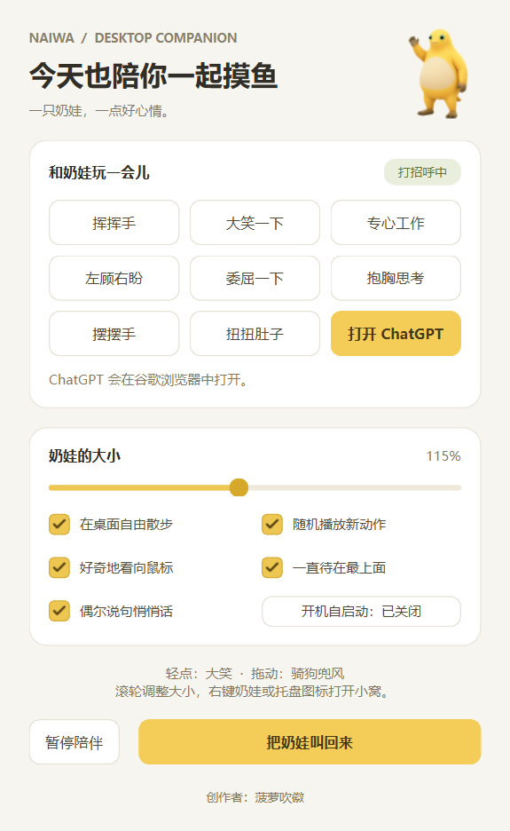

# 奶娃桌宠

**创作者：菠萝吹徽 · 版本 1.5 · Windows 桌面宠物**

`naiwa-desktop-pet` 是使用 Python / PySide6 编写的独立桌宠，基于 [timerring/codex-pet-naiwa](https://github.com/timerring/codex-pet-naiwa) 的动画素材。支持透明窗口、桌面散步、随机动作、拖动互动和开机自启动。

动画和互动在本机运行，无需 Codex 或 API Key。“奶娃的小窝”另有用谷歌 Chrome 打开 ChatGPT 网站的按钮。



## 使用

运行环境：Windows 10/11 x64。

在 [Releases](https://github.com/zhongyanhui2004/naiwa-desktop-pet/releases) 下载 Windows x64 便携 ZIP，解压后双击 **奶娃桌宠.exe**。请保留同目录下的 `_internal` 文件夹。首次运行会出现在主屏幕右下角。

| 操作 | 效果 |
| --- | --- |
| 左键轻点 | 播放捧腹大笑 |
| 按住左键拖动 | 移动奶娃并循环播放“骑狗兜风”，松手后恢复待机 |
| 鼠标滚轮 | 调整大小（60%–180%） |
| 鼠标悬停 | 间隔一段时间触发大笑 |
| 右键奶娃 | 打开动作菜单、小窝、暂停或退出 |
| 单击托盘图标 | 叫出奶娃 |
| 双击托盘图标 | 叫出奶娃并打开小窝 |
| 再次启动程序 | 显示已有奶娃并打开小窝 |

小窝提供动作预览、大小调整、自由散步、随机动作、看向鼠标、始终置顶、对话气泡和开机自启动开关。关闭小窝后，奶娃继续留在桌面；完全退出请使用右键菜单或托盘菜单中的 **退出奶娃**。

### 自动活动与拖动

- 自由散步默认约每 20–35 秒进行一次，活动范围为当前显示器的可用区域；拖动可搬到其他显示器。
- 随机动作包含“摆摆手”和“扭扭肚子”，空闲约 12–25 秒后播放两轮，与自由散步协调执行。
- 小窝或右键菜单打开、拖动、暂停期间，不会发起新的自动活动。
- “骑狗兜风”仅在拖动时触发，每次拖动从第一帧开始，按住时持续循环。暂停自动活动后也可以拖动，松手后保持暂停。
- 动画没有附加声音。

### 开机自启动与设置

在小窝中点击 **开机自启动：已开启／已关闭** 按钮即可切换。开启后，登录 Windows 时自动运行当前这份程序，不需要管理员权限。移动程序目录后，请在新位置重新开启。

位置、大小和互动开关保存在 `%LOCALAPPDATA%\NaiwaDesktopPet\settings.json`，运行日志位于同目录的 `naiwa.log`。自启动状态从 Windows 当前用户启动项读取。

### ChatGPT 入口

小窝内的 **打开 ChatGPT** 按钮使用已安装的谷歌 Chrome，新建标签页访问 `https://chatgpt.com/`。网站登录在浏览器内完成；此功能不在桌宠中嵌入聊天，也不调用 API。未找到 Chrome 时，小窝会显示提示。

## 源码运行

建议使用 Windows 10/11 x64 和 Python 3.12。

```powershell
git clone https://github.com/zhongyanhui2004/naiwa-desktop-pet.git
cd naiwa-desktop-pet
python -m venv .venv
.\.venv\Scripts\python.exe -m pip install -r requirements.txt
.\.venv\Scripts\python.exe main.py
```

也可以双击 `安装开发环境.bat`，安装完成后双击 `启动奶娃.bat`。

## 打包与验证

在项目根目录执行：

```powershell
.\.venv\Scripts\python.exe -m pip install -r requirements-build.txt
.\.venv\Scripts\python.exe -m unittest discover -s tests -v
.\.venv\Scripts\python.exe main.py --smoke-test --data-dir artifacts\smoke --report artifacts\smoke.json --preview-dir artifacts\preview
.\.venv\Scripts\python.exe build.py
.\.venv\Scripts\python.exe tools\verify_portable.py
.\.venv\Scripts\python.exe tools\verify_instance.py --exe dist\奶娃桌宠\奶娃桌宠.exe
```

打包产物为 `dist\奶娃桌宠\奶娃桌宠.exe` 和 `dist\奶娃桌宠-Windows-x64.zip`。便携包依赖同目录的 Qt 动态库，请整体分发。

## 替换或添加动作

原始动作位于 `assets/naifrog/spritesheet.webp`，布局由 `pet_core.py` 中的 `CLIPS` 定义。替换整套基础形象时，需要保持图集尺寸、帧大小和动作行布局一致，或同步修改加载代码。

额外动作位于 `assets/actions/`，在 `manifest.json` 中配置。每张 PNG 为透明背景、等大帧从左到右排列的单行图集。推荐帧大小为 192 × 208。例如，在 `actions` 数组中添加：

```json
{
  "id": "my_action",
  "name": "新动作",
  "sheet": "my_action.png",
  "frame_width": 192,
  "frame_height": 208,
  "frame_count": 24,
  "fps": 12,
  "loops": 2,
  "random": true
}
```

`id` 必须唯一；图集尺寸应为 `frame_width × frame_count` 宽、`frame_height` 高。`random` 控制是否参与随机播放。拖动动作使用 `"trigger": "drag"` 和 `"random": false`；替换现有 `q_drag` 条目即可更换拖动动画。

`tools/extract_recorded_actions.py` 和 `tools/extract_drag_action.py` 保留了现有动画的提取流程，依赖 `requirements-assets.txt` 中的可选工具。它们的裁切位置针对原素材，处理其他视频时需要自行调整；原视频不在仓库或便携包中。提取范围与来源摘要记录在 `assets/actions/SOURCE.json` 和 `assets/actions/q_drag_SOURCE.json`。

## 主要文件

| 路径 | 用途 |
| --- | --- |
| `main.py` | 启动、日志、单实例和验证入口 |
| `naiwa.py` | 桌宠窗口、动画、交互、托盘与小窝 |
| `pet_core.py` | 动作配置、方向计算和设置存储 |
| `browser_launch.py` | 查找 Chrome 并打开 ChatGPT |
| `autostart.py` | 当前用户 Windows 自启动项管理 |
| `assets/` | 基础图集、额外动作和应用图标 |
| `tests/`、`tools/` | 自动化测试、打包验证和素材处理 |
| `third_party/` | 上游来源、第三方说明和许可证 |

## 素材与许可

新增桌面程序代码按 [MIT License](LICENSE) 开源。**角色、美术和动画等第三方素材不因代码开源而获得 MIT 授权**；使用、修改或再分发这些素材时，须另行确认相应权利。

基础素材来自 [timerring/codex-pet-naiwa](https://github.com/timerring/codex-pet-naiwa)，固定上游提交为 `3c0cd7ca231f02e0d4d6956fc6ce86eb9f0cfb50`。上游原创内容采用 MIT，但其 README 明确排除了致谢中列出的第三方素材。额外动作同样不在本项目代码的 MIT 授权范围内。

上游致谢：[Nitrogen216/awesome_pets](https://github.com/Nitrogen216/awesome_pets)、[LynnShaw/naiwa-pet](https://github.com/LynnShaw/naiwa-pet)。

PySide6 / Qt 使用开源 LGPLv3 发行版，动态库保留在便携包的 `_internal` 目录。完整来源与依赖许可证见 [third_party/NOTICE.md](third_party/NOTICE.md)。
